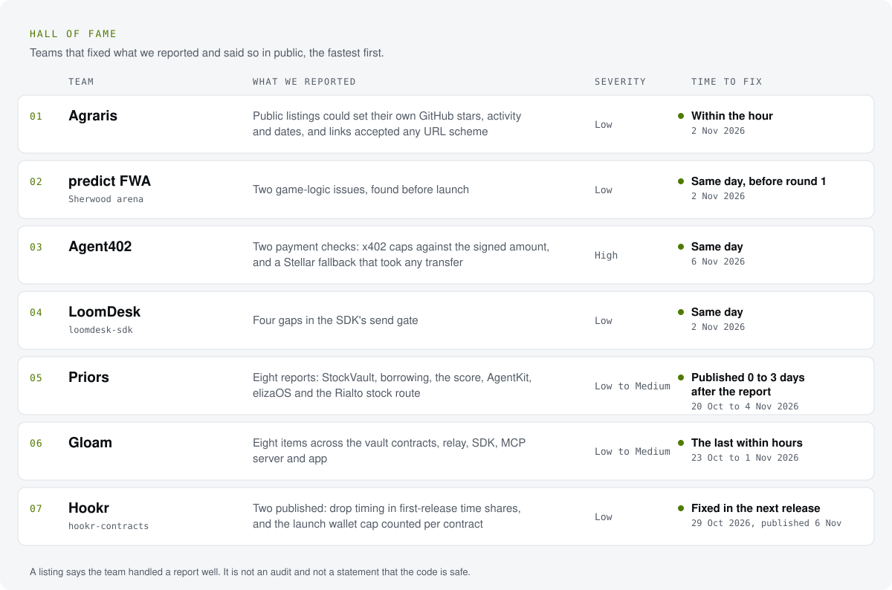

# Hall of fame

Teams that fixed what we reported and said so in public. Listed by how quickly they shipped a fix after our report,
then by name. Being listed here says the team handled a report well. It is not an audit and not a statement that the
code is safe.

<picture>
  <source media="(prefers-color-scheme: dark)" srcset="assets/hall-dark.svg">
  
</picture>

## The credits, with links

| Team | What we reported | Time to fix | Credit |
|---|---|---|---|
| **Agraris** | Public listings could set their own GitHub stars, activity and dates, and links accepted any URL scheme (Low) | Within the hour (2 Nov 2026) | [Commit 177e360](https://github.com/agrarisai/agraris/commit/177e360) · [post on X](https://x.com/agrarisai/status/2117276441310335355) |
| **predict FWA** (Sherwood arena) | Two game-logic issues found before launch (Low) | Same day, before round 1 (2 Nov 2026) | [Security review in the README](https://github.com/MirakoolDev/sherwood#security-review-nov-2026) · [post on X](https://x.com/pfwafun/status/2117205853539353009) |
| **Agent402** | Two payment issues: the x402 buyer signed the seller's `maxAmountRequired` while spend caps checked `amount`, and the Stellar settle fallback took any recent transfer from the payer as payment (High) | Same day (6 Nov 2026) | [GHSA-q7vw](https://github.com/MikeyPetrillo/Agent402/security/advisories/GHSA-q7vw-c7hm-m885) · [GHSA-gcw5](https://github.com/MikeyPetrillo/Agent402/security/advisories/GHSA-gcw5-6259-gh72) · [post on X](https://x.com/Agent402Tools/status/2118727213222617597) |
| **LoomDesk** (loomdesk-sdk) | Four gaps in the SDK's send gate (Low) | Same day (2 Nov 2026) | [0.7.1, commit 2e97226](https://github.com/loomdesk-hq/sdk/commit/2e97226) |
| **Priors** | Eight reports: StockVault, borrowing, the score, the AgentKit and elizaOS integrations, and the Rialto stock route (Low to Medium) | Published 0 to 3 days after the report (20 Oct to 4 Nov 2026) | [GHSA-3vg6](https://github.com/priors-agents/priors/security/advisories/GHSA-3vg6-2f3m-j5qm) · [GHSA-qcrq](https://github.com/priors-agents/priors/security/advisories/GHSA-qcrq-x8xg-25vg) · [GHSA-xccq](https://github.com/priors-agents/priors/security/advisories/GHSA-xccq-5ghg-w7mq) · [GHSA-jjxq](https://github.com/priors-agents/priors/security/advisories/GHSA-jjxq-7r68-44m5) · [GHSA-4w7q](https://github.com/priors-agents/priors/security/advisories/GHSA-4w7q-8vph-j5mr) · [GHSA-p29w](https://github.com/priors-agents/priors/security/advisories/GHSA-p29w-c8p2-qfm5) · [GHSA-cqcw](https://github.com/priors-agents/priors/security/advisories/GHSA-cqcw-9qjc-5qc7) · [credits in SECURITY-v2](https://github.com/priors-agents/priors/blob/main/docs/SECURITY-v2.md) |
| **Gloam** | Eight items across the vault contracts, relay, SDK, MCP server and app (Low to Medium) | The last within hours (23 Oct to 1 Nov 2026) | [Joint post on X](https://x.com/HeyResearch/status/2117263881815118077) |

## The numbers so far

<!-- NUMBERS:START -->
- 28 private security advisories filed on GitHub, across 9 projects. 18 accepted or published by their teams.
- 289 pull requests to 230 other teams' repositories, 56 merged.
- 6 teams in the hall of fame.

Advisories counted by hand, last on 6 November 2026. Pull requests read from GitHub search every day.
<!-- NUMBERS:END -->

Your team can be next: see the [disclosure policy](README.md).
