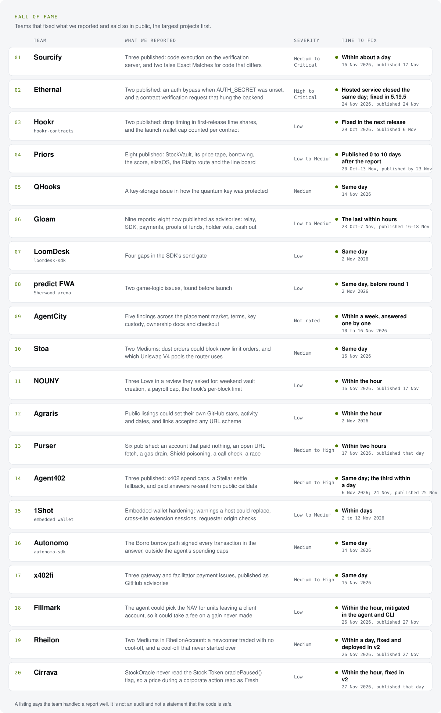

# Hall of fame

Teams that fixed what we reported and said so in public, the largest projects first. Being listed here says the team
handled a report well. It is not an audit and not a statement that the code is safe.

<picture>
  <source media="(prefers-color-scheme: dark)" srcset="assets/hall-dark.svg">
  
</picture>

## The credits, with links

| Team | What we reported | Time to fix | Credit |
|---|---|---|---|
| **Sourcify** | Three advisories in the open-source contract verification service run by the Argot Collective, published by the team: two input checks in the public verify endpoint could be combined so that anyone, with no account, made the verification server download a git repository and run a file from it (Critical); a match on an old creation transaction alone stored an Exact Match for an address that now holds different code (Medium); and the library call protection left the first 21 bytes of on-chain code unchecked, so a library that starts with other code still got an Exact Match (Medium) | Within about a day (reported 16 Nov 2026, fixed 17 Nov in sourcify-server 4.4.0, lib-sourcify 3.8.1 and compilers 1.4.1); advisories published by the team the same day | [GHSA-726m](https://github.com/argotorg/sourcify/security/advisories/GHSA-726m-wjrf-m267) · [GHSA-w97v](https://github.com/argotorg/sourcify/security/advisories/GHSA-w97v-g4q9-998q) · [GHSA-mg7q](https://github.com/argotorg/sourcify/security/advisories/GHSA-mg7q-xhfh-rmfq) · [fix PR #3072](https://github.com/argotorg/sourcify/pull/3072) · [fix PR #3073](https://github.com/argotorg/sourcify/pull/3073) · [fix PR #3074](https://github.com/argotorg/sourcify/pull/3074) |
| **Ethernal** | Two advisories in the open-source block explorer, published by the team: when `AUTH_SECRET` was unset, as the self-hosted installer left it, any request naming a user id was accepted as that user, so anyone could read an admin's API token and the faucet's private key (Critical); and one unauthenticated contract-verification request with crafted constructor arguments looped the backend forever (High) | The hosted service was closed the same day the report was read; both fixed in 5.19.5 (24 Nov 2026) and the advisories published by the team the same day | [GHSA-h95w](https://github.com/tryethernal/ethernal/security/advisories/GHSA-h95w-84r3-2wmx) · [GHSA-gcv3](https://github.com/tryethernal/ethernal/security/advisories/GHSA-gcv3-72c3-2jq3) · [fix PR #1419](https://github.com/tryethernal/ethernal/pull/1419) |
| **Hookr** (hookr-contracts) | Two published: in first-release time shares a lock made after a drop could share in that drop, and the per-wallet launch cap counted per contract for router swaps (Low). Nobody was exposed | Fixed in the next release (29 Oct 2026), advisories published 6 Nov | [GHSA-43mv](https://github.com/Hookr-fun/hookr-contracts/security/advisories/GHSA-43mv-935h-rpm7) · [GHSA-m3fx](https://github.com/Hookr-fun/hookr-contracts/security/advisories/GHSA-m3fx-pjvg-cmf7) |
| **Priors** | Eight published advisories: StockVault and its PT-USDG price tape, borrowing, the score, the elizaOS integration, the Rialto stock route, and, credited with another reporter, `line_send` in @priors/mcp, which with the line board turned on (off by default) sent a line without checking it against the root owner's own signed offer (Low to Medium) | Published 0 to 10 days after the report (reported 20 Oct to 13 Nov 2026, the last published 23 Nov) | [GHSA-3vg6](https://github.com/priors-agents/priors/security/advisories/GHSA-3vg6-2f3m-j5qm) · [GHSA-qcrq](https://github.com/priors-agents/priors/security/advisories/GHSA-qcrq-x8xg-25vg) · [GHSA-xccq](https://github.com/priors-agents/priors/security/advisories/GHSA-xccq-5ghg-w7mq) · [GHSA-jjxq](https://github.com/priors-agents/priors/security/advisories/GHSA-jjxq-7r68-44m5) · [GHSA-4w7q](https://github.com/priors-agents/priors/security/advisories/GHSA-4w7q-8vph-j5mr) · [GHSA-p29w](https://github.com/priors-agents/priors/security/advisories/GHSA-p29w-c8p2-qfm5) · [GHSA-cqcw](https://github.com/priors-agents/priors/security/advisories/GHSA-cqcw-9qjc-5qc7) · [GHSA-98wp](https://github.com/priors-agents/priors/security/advisories/GHSA-98wp-7ghc-6f3w) · [credits in SECURITY-v2](https://github.com/priors-agents/priors/blob/main/docs/SECURITY-v2.md) |
| **QHooks** | A key-storage issue in how the quantum key was protected (Medium) | Same day (14 Nov 2026) | [Security changelog](https://qhooks.com/changelog#quantum-key-protection) |
| **Gloam** | Eight items across the vault contracts, relay, SDK, MCP server and app, seven of them now published as advisories (Low to Medium); and a ninth, filed 7 Nov: in gloam-cashout a payment was tied to its quote only by amount, so one payer's cash out could redeem another quote (Medium) | The last of the eight within hours (23 Oct to 1 Nov 2026), advisories published 16 Nov; the ninth fixed in @gloamtrade/sdk 0.7.1 and published 18 Nov | [GHSA-wxv6](https://github.com/gloamtrade/gloam/security/advisories/GHSA-wxv6-6fjw-c2m9) · [GHSA-5gwv](https://github.com/gloamtrade/gloam/security/advisories/GHSA-5gwv-jpjr-x34r) · [GHSA-p2wm](https://github.com/gloamtrade/gloam/security/advisories/GHSA-p2wm-6x89-63c2) · [GHSA-x8fx](https://github.com/gloamtrade/gloam/security/advisories/GHSA-x8fx-frxx-7f66) · [GHSA-fqc9](https://github.com/gloamtrade/gloam/security/advisories/GHSA-fqc9-v45x-jfh8) · [GHSA-vqqr](https://github.com/gloamtrade/gloam/security/advisories/GHSA-vqqr-hg6r-779w) · [GHSA-rvhx](https://github.com/gloamtrade/gloam/security/advisories/GHSA-rvhx-3m36-4g8h) · [GHSA-4whx](https://github.com/gloamtrade/gloam/security/advisories/GHSA-4whx-32vw-75gp) · [joint post on X](https://x.com/HeyResearch/status/2117263881815118077) |
| **LoomDesk** (loomdesk-sdk) | Four gaps in the SDK's send gate (Low) | Same day (2 Nov 2026) | [0.7.1, commit 2e97226](https://github.com/loomdesk-hq/sdk/commit/2e97226) |
| **predict FWA** (Sherwood arena) | Two game-logic issues found before launch (Low) | Same day, before round 1 (2 Nov 2026) | [Security review in the README](https://github.com/MirakoolDev/sherwood#security-review-nov-2026) · [post on X](https://x.com/pfwafun/status/2117205853539353009) |
| **AgentCity** | Five findings across the placement market contract, the terms page, key custody, contract ownership docs and the checkout, one with a Foundry test; a second round of five smaller notes | Within a week (10 to 16 Nov 2026), each answered in public | [AgentCity's write-up](https://github.com/agentcitylabs/research/blob/main/%5BRnDAC%5D-SecurityReview_HEYResearchLab.md) |
| **Stoa** | A requested review of RugCover, SpotlightMarket, StoaLimit and StoaRouter at a pinned commit. Two Medium findings, each with a fork test: anyone could block new limit orders with dust (StoaLimit), and a finding about which Uniswap V4 pools the router uses | Same day (16 Nov 2026); the new V4 adapter goes live through Stoa's 48-hour timelock | [Stoa's security review page](https://stoadex.com/docs/security-review) |
| **NOUNY** | A review of the contracts NOUNY asked for. Three Low findings, each with a fork test: new AgentVaults could not be created while the stock price feeds paused each weekend, removed payroll recipients still counted toward the 100-recipient cap, and NounyHook's one-swap-per-block limit used the L1 block number on Robinhood Chain (Low) | Within the hour (16 Nov 2026), fixed and redeployed; advisories published by the team on 17 Nov | [GHSA-9j35](https://github.com/nounyagent/nouny-agent/security/advisories/GHSA-9j35-fvff-78xp) · [GHSA-2f3v](https://github.com/nounyagent/nouny-agent/security/advisories/GHSA-2f3v-w6ff-pm77) · [GHSA-ggxm](https://github.com/nounyagent/nouny-agent/security/advisories/GHSA-ggxm-63r4-39pp) · [fix commit e79bca2](https://github.com/nounyagent/nouny-agent/commit/e79bca2) |
| **Agraris** | Public listings could set their own GitHub stars, activity and dates, and links accepted any URL scheme (Low) | Within the hour (2 Nov 2026) | [Commit 177e360](https://github.com/agrarisai/agraris/commit/177e360) · [post on X](https://x.com/agrarisai/status/2117276441310335355) |
| **Purser** | Six advisories, published by the team: any contract could pose as a Purser account, so the engine took a `Paid` event that moved nothing as proof of payment (High); the engine fetched any URL for an agent key and returned the answer, internal addresses included (Medium); a caller with no key could use up the relayer's daily gas budget through the x402 facilitator (Medium); one request with no key could put an honest payee on the shared Purser Shield list, so accounts paying it were refused or frozen (Medium); the firewall's check for takeover calls such as `transferOwnership` never saw the agent's own call on the simulation backend the live node uses (Medium); and model calls sent at the same time all passed the check before the call for models at cost, so an account could run up calls it never paid for (Medium) | Within two hours (17 Nov 2026), fixed in commit 81e92e6, the last fixes in commit 7cb16e6 the same day; all six advisories published by the team the same day | [GHSA-ch98](https://github.com/PurserAgents/purser/security/advisories/GHSA-ch98-775j-jhhv) · [GHSA-3h6j](https://github.com/PurserAgents/purser/security/advisories/GHSA-3h6j-gjj9-vwcm) · [GHSA-mwgj](https://github.com/PurserAgents/purser/security/advisories/GHSA-mwgj-gf6x-gm67) · [GHSA-59mh](https://github.com/PurserAgents/purser/security/advisories/GHSA-59mh-vw5p-vr3f) · [GHSA-gx7f](https://github.com/PurserAgents/purser/security/advisories/GHSA-gx7f-32pr-9pmr) · [GHSA-6gqp](https://github.com/PurserAgents/purser/security/advisories/GHSA-6gqp-w3qv-9vfv) · [fix commit 81e92e6](https://github.com/PurserAgents/purser/commit/81e92e6) · [fix commit 7cb16e6](https://github.com/PurserAgents/purser/commit/7cb16e6) |
| **Agent402** | Three published advisories: the x402 buyer signed the seller's `maxAmountRequired` while spend caps checked `amount`, and the Stellar settle fallback took any recent transfer from the payer as payment (High); and, filed 24 Nov, the `/ref` re-send path served a buyer's paid answer to anyone who rebuilt the payment from its public settlement calldata (Medium) | The first two the same day (6 Nov 2026); the third within a day, fixed in 2.16.0 and published by the team on 25 Nov | [GHSA-q7vw](https://github.com/MikeyPetrillo/Agent402/security/advisories/GHSA-q7vw-c7hm-m885) · [GHSA-gcw5](https://github.com/MikeyPetrillo/Agent402/security/advisories/GHSA-gcw5-6259-gh72) · [GHSA-fh6c](https://github.com/MikeyPetrillo/Agent402/security/advisories/GHSA-fh6c-767w-5ppj) · [post on X](https://x.com/Agent402Tools/status/2118727213222617597) |
| **1Shot** (embedded wallet) | Hardening across the open-source embedded wallet: risk warnings an embedding site could replace, one site's extension session usable by another, and requester origins that could be wrong or chosen by an attacker (Low to Medium) | Within days (2 to 12 Nov 2026), across several releases | [post on X](https://x.com/1shotapi/status/2121327154864738646) |
| **Autonomo** (autonomo-sdk) | When an agent's wallet was short, the SDK's Borro borrow path signed and sent every transaction in the answer it got back, outside the agent's spending caps (Medium) | Same day (14 Nov 2026), fixed in both SDKs (npm autonomo-sdk 0.1.3, PyPI autonomo 0.1.1) and re-tested by us | [post on X](https://x.com/useautonomo/status/2121624143187812566) |
| **x402fi** | Three payment issues in the gateway and the public facilitator: an encoded `../` priced as one endpoint and forwarded to another (High), `/settle` paying gas for transfers that pay nobody (Medium), and paid calls forwarded when the payment cannot settle (Medium) | Same day (15 Nov 2026), advisories published by the team | [GHSA-2695](https://github.com/RWA-ID/x402fi/security/advisories/GHSA-2695-fqv4-x6wm) · [GHSA-4mf4](https://github.com/RWA-ID/x402fi/security/advisories/GHSA-4mf4-56v3-jvm7) · [GHSA-9g6h](https://github.com/RWA-ID/x402fi/security/advisories/GHSA-9g6h-3x75-ghv9) |

## The numbers so far

<!-- NUMBERS:START -->
- 145 private security advisories filed on GitHub, across 72 projects. 45 accepted or published by their teams.
- 278 pull requests to 220 other teams' repositories, 54 merged.
- 17 teams in the hall of fame.

Advisories counted by hand, last on 26 November 2026. Pull requests read from GitHub search every day.
<!-- NUMBERS:END -->

Your team can be next: see the [disclosure policy](README.md).
