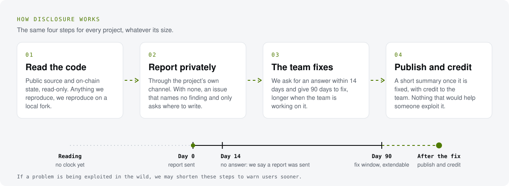
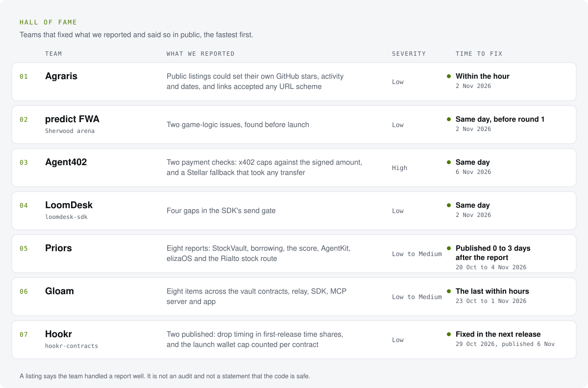

<a href="https://heyresearch.xyz">
  <picture>
    <source media="(prefers-color-scheme: dark)" srcset="assets/hero-dark.svg">
    
  </picture>
</a>

  
  
  
  

  We read the open-source code of projects building on Robinhood Chain. When we find a security problem, we report it 
  to the team privately, give them time to fix it, and credit them when it ships. This page is how we do that, what we 
  ask in return and when we speak publicly. It applies to every project the same way, whatever its size.

  <a href="#how-disclosure-works">How disclosure works</a> ·
  <a href="#timeline">Timeline</a> ·
  <a href="#what-we-never-do">What we never do</a> ·
  <a href="#what-we-ask">What we ask</a> ·
  <a href="#hall-of-fame">Hall of fame</a> ·
  <a href="#contact">Contact</a>

<picture>
  <source media="(prefers-color-scheme: dark)" srcset="assets/numbers-dark.svg">
  
</picture>

## How disclosure works

<picture>
  <source media="(prefers-color-scheme: dark)" srcset="assets/flow-dark.svg">
  
</picture>

1. **Privately first, always.** We use the project's own channel: GitHub private vulnerability reporting, a security
   email, or a direct message to the team.
2. **No private channel?** We open a short "Security contact request" issue on the repository. It names no finding, no
   file and no severity. It only asks where to send the details.
3. **What a report contains.** The commit we read, where the problem is, a step-by-step sequence, the impact, what we
   measured on chain (read-only), and a suggested fix.

## Timeline

| Day | What happens |
|---|---|
| **0** | We send the report privately, or the contact request when there is no private channel. |
| **14** | If nobody has acknowledged it, we say publicly that we sent a report to the project and are waiting to hear back. No details, no severity, no file names. |
| **90** | The fix window ends. If the team is working on it, we extend it: just tell us. |
| **After the fix, or at 90 days** | We publish a short summary and credit the team that fixed it. If it is still unfixed at 90 days, we tell users how to protect themselves and still leave out anything that would help someone exploit it. |

If we see a problem being exploited in the wild, we may shorten these steps to warn users sooner.

## What we never do

- **Touch live systems.** We never send a transaction, touch user funds or test against live systems. We read source
  code and on-chain state, and we reproduce on local forks only.
- **Publish an exploit early.** No exploit code or step-by-step details before a fix ships.
- **Ask for money.** Our reviews are free.
- **Mix it with our research.** A report never changes how HEY ranks or scores a project. Security reports are kept
  apart from HEY's research.

## What we ask

- **An acknowledgement**, so we know the report arrived.
- **A fix**, or a clear "we accept this risk" with a reason.
- **Credit**: on the GitHub advisory, in your changelog, or a short post on X tagging
  [x.com/HeyResearch](https://x.com/HeyResearch). We are a small team, and credit is how other builders find us.

## Hall of fame

<a href="HALL_OF_FAME.md">
  <picture>
    <source media="(prefers-color-scheme: dark)" srcset="assets/hall-dark.svg">
    
  </picture>
</a>

Every credit with its link, and the numbers so far: [HALL_OF_FAME.md](HALL_OF_FAME.md).

## Contact

| | |
| --- | --- |
| **X** | [x.com/HeyResearch](https://x.com/HeyResearch) |
| **Email** | hi@heyresearch.xyz |
| **Your repository** | Turn on [private vulnerability reporting](https://docs.github.com/en/code-security/security-advisories/working-with-repository-security-advisories/configuring-private-vulnerability-reporting-for-a-repository) and we report there. |

Open source on Robinhood Chain? Send us the repo and we will read it too.

The pictures on this page are redrawn every day by <a href="scripts/refresh.mjs">scripts/refresh.mjs</a>: the advisory counts are kept by hand in
<a href="data/advisories.json">data/advisories.json</a>, the pull requests are read from GitHub search. Community-run by Hey Research Lab ·
not affiliated with or endorsed by Robinhood · not investment advice.

